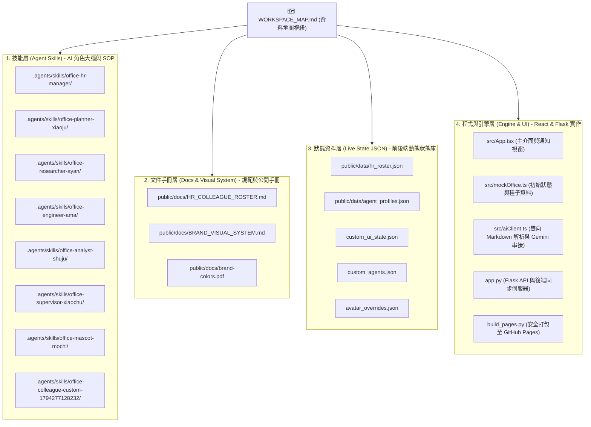

# 🗺️ 無所事事辦公室（AI Office）— 工作區架構與資料地圖 (Workspace Data Map)

> **版本**：v1.0 (2026-11-10)  
> **維護單位**：AI Office HR 人事總署（`office-hr-manager`）與全端系統架構部（`office-engineer-ama`）  
> **核心用途**：作為本工作區唯一的「四層架構導航索引（Hub）」，標定所有同事技能、文件、狀態資料與程式碼的單一真相來源（SSOT），提供一鍵直達超連結。

---

## 📌 一、 四層架構全景索引

---

## 🧭 二、 各層核心檔案清單與直達連結

### 1. 技能層 (Agent Skills Layer)
*存放於工作區根目錄 `.agents/skills/`，是各 AI 同事被喚醒時載入的唯一人格與作業規範（SOP）。*

| 同事代號 | 名稱與職稱 | 專屬技能包路徑 | 核心職責 |
| :---: | :--- | :--- | :--- |
| `hr` | **HR 管理員** | [`office-hr-manager/SKILL.md`](file:///d:/AI/.agents/skills/office-hr-manager/SKILL.md) | 全體同事 6 大欄位維護、名冊稽核與多端同步 |
| `planner` | **小橘（策劃）** | [`office-planner-xiaoju/SKILL.md`](file:///d:/AI/.agents/skills/office-planner-xiaoju/SKILL.md) | 產品路線圖、MVP 範圍拆解、P0/P1/P2 排序 |
| `researcher` | **阿研（研究）** | [`office-researcher-ayan/SKILL.md`](file:///d:/AI/.agents/skills/office-researcher-ayan/SKILL.md) | UX 使用者訪談、遊戲化視覺、網站 CSS/變數動態調校 |
| `engineer` | **阿碼（工程師）** | [`office-engineer-ama/SKILL.md`](file:///d:/AI/.agents/skills/office-engineer-ama/SKILL.md) | React/TS 前端、Flask API、9:16 手機排版與部署 |
| `analyst` | **數據（分析師）** | [`office-analyst-shuju/SKILL.md`](file:///d:/AI/.agents/skills/office-analyst-shuju/SKILL.md) | 問卷統計、事件流漏斗、代理人卡關異常數據診斷 |
| `virgo` | **小處（處女座監督）** | [`office-supervisor-xiaochu/SKILL.md`](file:///d:/AI/.agents/skills/office-supervisor-xiaochu/SKILL.md) | 驗收把關、素材授權審查、上線前 Checklist 攔截 |
| `momo` | **米米（吉祥物）** | [`office-mascot-mochi/SKILL.md`](file:///d:/AI/.agents/skills/office-mascot-mochi/SKILL.md) | 團隊士氣激勵、品牌溫暖語氣、破冰與療癒支援 |
| `custom-1794277128232` | **東東（吉祥物 2）** | [`office-colleague-custom-1794277128232/SKILL.md`](file:///d:/AI/.agents/skills/office-colleague-custom-1794277128232/SKILL.md) | 跨區巡邏打氣、陪伴米米炒熱氣氛 |

---

### 2. 文件手冊層 (Docs Layer — 原始源頭)
*特別注意：所有手冊的**編輯源頭**均位於 `ai-office-prototype/public/docs/`，經由 `build_pages.py` 打包發布至根目錄 `docs/` 供 GitHub Pages 讀取。請勿直接修改打包產物。*

- 🪪 **HR 人事手冊總冊 (SSOT)**：
  - 來源檔案：[`public/docs/HR_COLLEAGUE_ROSTER.md`](file:///d:/AI/ai-office-prototype/public/docs/HR_COLLEAGUE_ROSTER.md)
  - 鏡像路徑：[`docs/HR_COLLEAGUE_ROSTER.md`](file:///d:/AI/ai-office-prototype/docs/HR_COLLEAGUE_ROSTER.md)
- 🎨 **品牌視覺化系統規範 (Brand Visual Spec)**：
  - Markdown 規範：[`public/docs/BRAND_VISUAL_SYSTEM.md`](file:///d:/AI/ai-office-prototype/public/docs/BRAND_VISUAL_SYSTEM.md)
  - 向量 PDF 原檔：[`public/docs/brand-colors.pdf`](file:///d:/AI/ai-office-prototype/public/docs/brand-colors.pdf)
  - PDF 產生腳本：[`generate_brand_pdf.py`](file:///d:/AI/ai-office-prototype/generate_brand_pdf.py)

---

### 3. 狀態資料層 (Live State JSON Layer)
*儲存執行階段（Runtime）同事屬性與自訂介面設定，支援 Web 前端與 Python 後端雙向持久化。*

- 👥 **人事名冊結構 JSON**：[`public/data/hr_roster.json`](file:///d:/AI/ai-office-prototype/public/data/hr_roster.json)
- 🏷️ **同事動態屬性覆蓋庫**：[`public/data/agent_profiles.json`](file:///d:/AI/ai-office-prototype/public/data/agent_profiles.json)
- 🖼️ **自訂頭像覆蓋庫**：[`avatar_overrides.json`](file:///d:/AI/ai-office-prototype/avatar_overrides.json)
- 🧑🏻‍🎨 **新招募自訂同事庫**：[`custom_agents.json`](file:///d:/AI/ai-office-prototype/custom_agents.json)
- 🎨 **阿研動態介面樣式庫**：[`custom_ui_state.json`](file:///d:/AI/ai-office-prototype/custom_ui_state.json)

---

### 4. 程式與引擎層 (Engine & UI Layer)
*驅動辦公室 6 大區域互動、通知視窗、AI 推論與自動化建置的核心程式碼。*

- 🖥️ **主應用元件與通知視窗**：[`src/App.tsx`](file:///d:/AI/ai-office-prototype/src/App.tsx)
- 🏢 **辦公室空間與預設同事資料**：[`src/mockOffice.ts`](file:///d:/AI/ai-office-prototype/src/mockOffice.ts)
- 🧠 **雙向 Markdown 解析與 Gemini 串接**：[`src/aiClient.ts`](file:///d:/AI/ai-office-prototype/src/aiClient.ts)
- 📡 **事件流與狀態廣播匯流排**：[`src/officeDataSource.ts`](file:///d:/AI/ai-office-prototype/src/officeDataSource.ts)
- 🐍 **後端 API 與 Skill 同步伺服器**：[`app.py`](file:///d:/AI/ai-office-prototype/app.py)
- 🚀 **安全打包與 GitHub Pages 部署器**：[`build_pages.py`](file:///d:/AI/ai-office-prototype/build_pages.py)

---

## 🛠️ 三、 最佳查詢與維護作業流程 (Workflow Rules)

1. **若想修改同事個人資訊（名稱、職能、定位、頭像、專長、個性）**：
   - **方式 A（GUI 視覺化）**：在網站點擊「🪪 HR 檔案館」或「✎ 角色設定」，儲存後畫面、SKILL.md 與 JSON 自動全部同步。
   - **方式 B（文件批次編輯）**：直接開啟 [`public/docs/HR_COLLEAGUE_ROSTER.md`](file:///d:/AI/ai-office-prototype/public/docs/HR_COLLEAGUE_ROSTER.md) 編輯，儲存後在前端點擊「💾 根據 HR 文本更新全體同事資料」或呼叫後端 API 即完成全域同步。
2. **若想查詢色彩與排版規範**：
   - 開啟 [`public/docs/BRAND_VISUAL_SYSTEM.md`](file:///d:/AI/ai-office-prototype/public/docs/BRAND_VISUAL_SYSTEM.md) 或在網站附件點開 `brand-colors.pdf` 視窗。
3. **部署與上線**：
   - 執行 `python build_pages.py`，腳本會自動將 `public/docs/` 中的最新手冊與 `public/data/` 同步至發布目錄 `docs/`，保證不會覆蓋任何修改。
